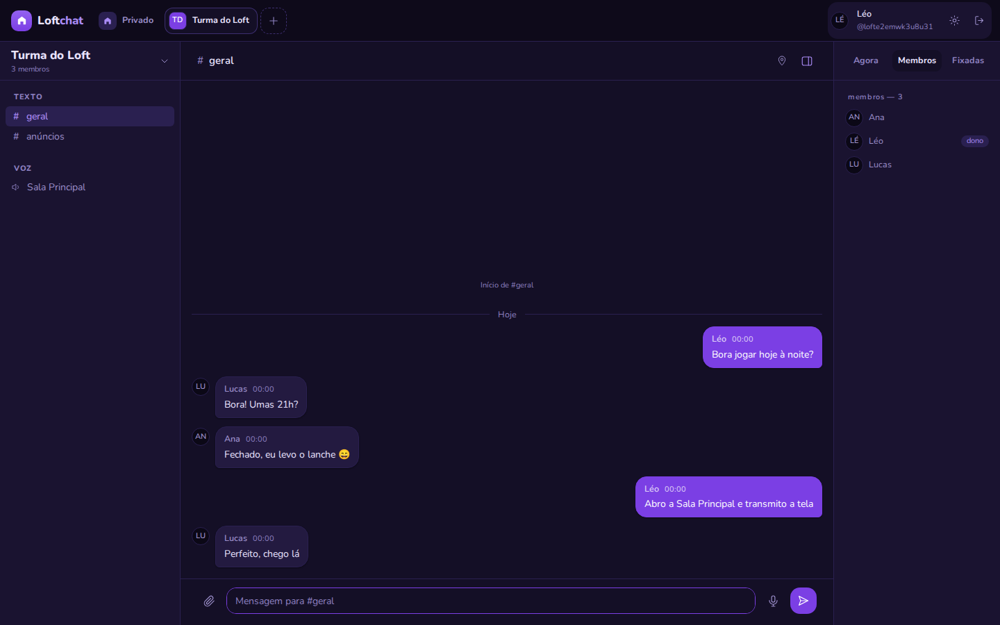
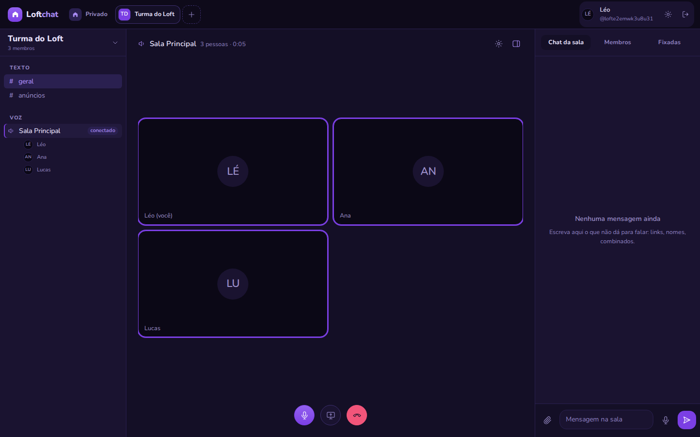
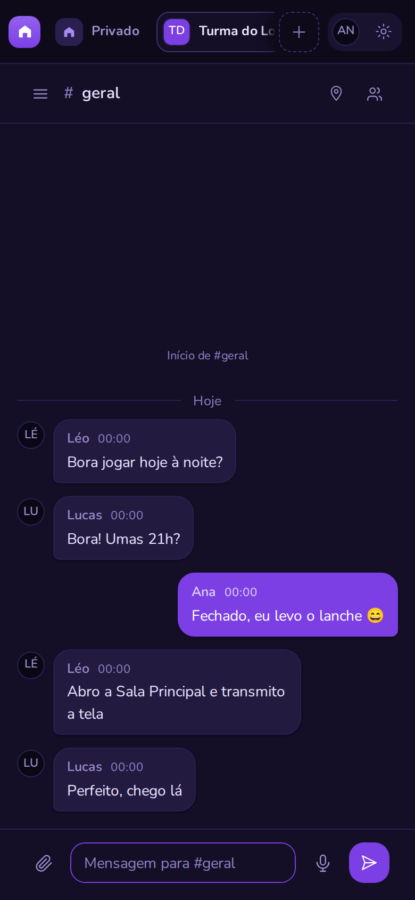

<div align="center">


# Loftchat

**Seus grupos, sua tela, do seu jeito.**

Chat, salas de voz e transmissão de tela com som para você e seus amigos.<br>
Grátis, sem anúncios e personalizável de verdade.

[**loftchat.com.br**](https://loftchat.com.br)

<sub>Em beta: no computador (Windows e Linux) e no celular (Android).</sub>

<br>



</div>

## O que dá para fazer

- 💬 **Grupos com canais de texto:** mensagens, fotos, mensagens fixadas e canais organizados em categorias.
- 🎙️ **Salas de voz:** entra com um toque, vê quem está falando e conversa por escrito no chat da própria sala.
- 🖥️ **Transmitir a tela com som:** mostra o jogo do PC para a turma, com o áudio junto. No celular, transmite a tela do Android.
- 🎨 **Do seu jeito:** perfil com foto, capa, cor do nome e status; tema claro ou escuro; fundo do chat.
- 🔗 **Convite por código:** cada grupo tem um código de 6 letras. Quem recebe entra pelo **+ → Entrar num grupo**.
- 🔒 **Privado:** conversas um a um com os amigos, fora dos grupos.

<table>
  <tr>
    <td width="68%"></td>
    <td width="32%"></td>
  </tr>
  <tr>
    <td align="center"><sub>Sala de voz no computador</sub></td>
    <td align="center"><sub>No celular</sub></td>
  </tr>
</table>

## Baixar

| Onde | Como |
| --- | --- |
| 🪟 Windows | Instalador `Loftchat-Setup.exe`, em breve nas [Releases](https://github.com/Lelokz/Loftchat.com.br/releases) |
| 🐧 Linux | `Loftchat.AppImage`, em breve nas [Releases](https://github.com/Lelokz/Loftchat.com.br/releases) |
| 🤖 Android | APK, em breve nas [Releases](https://github.com/Lelokz/Loftchat.com.br/releases) |

O programa do computador e o app do Android se atualizam sozinhos.

## Feito com

TypeScript + Vite no chat · Firebase (login e banco de dados) · WebRTC (voz e tela, direto entre as pessoas) · Electron (programa do computador) · Capacitor (app Android)

<details>
<summary><b>Para quem vai mexer no código</b></summary>

<br>

- [COMO-RODAR.md](COMO-RODAR.md): do computador zerado até rodar o chat, os testes e publicar.
- [PROGRESSO.md](PROGRESSO.md): o diário do projeto, com as decisões, os defeitos conhecidos e o que falta.

```bash
npm install
npm run dev        # o chat no navegador
npm test           # os testes, num Firebase de teste no próprio PC
```

</details>

## Direitos

© 2026 Lelokz. Todos os direitos reservados.<br>
O código está aberto para leitura, mas não pode ser copiado, modificado nem usado em outros projetos sem autorização.
